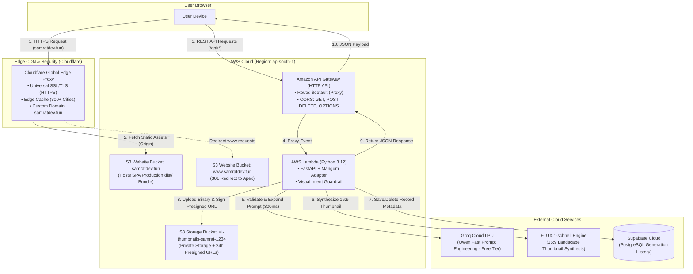

# AI Thumbnail Generator — System Architecture & Design Blueprint

## 1. Project Overview
An AI-powered web application specifically engineered for generating, editing, and managing 16:9 YouTube thumbnails.
The application provides:
- **Text-to-Thumbnail**: Transforming raw concepts into click-optimized, cinematic 16:9 YouTube thumbnails.
- **Image-to-Image Editing**: Uploading an existing thumbnail or subject image and instructing the AI to modify visual attributes (lighting, composition, scene background).
- **Strict Visual Intent Guardrail**: Rejecting non-image requests (e.g. general questions, coding requests) at the backend API layer.
- **Persistent Cloud History**: Auto-syncing generated thumbnails to PostgreSQL database with interactive modal previews and granular/bulk deletion.

---

## 2. Technology Stack & Architectural Decisions

| Component | Technology | Rationale & Responsibility |
| :--- | :--- | :--- |
| **Frontend** | React 19 + Vite 8 + CSS Design System | Pure client-side SPA. Zero server runtime, sub-150ms builds, hosted on S3 and edge-cached globally via Cloudflare CDN. |
| **Backend API** | Python 3.12 (FastAPI) + Mangum | Asynchronous REST framework with native Pydantic data validation and auto-generated Swagger UI (`/docs`). Mangum adapts ASGI to AWS Lambda. |
| **Serverless Compute**| AWS Lambda (`ap-south-1`) | Scales to zero ($0 idle cost), executes backend logic in an isolated containerized environment without EC2 server maintenance. |
| **API Gateway** | Amazon API Gateway (HTTP API) | Serverless ingress proxy routing `$default` requests to AWS Lambda with explicit CORS preflight support. |
| **Edge CDN & SSL** | Cloudflare Global CDN + Universal SSL | Global edge caching across 300+ cities, DDoS mitigation, and instant HTTPS termination on custom domain `https://samratdev.fun`. |
| **Database** | Supabase (PostgreSQL) | Serverless PostgreSQL database with real-time REST client, zero-config connection pooling, storing generation history and prompt metadata. |
| **Object Storage**| Amazon S3 (`ap-south-1`) | 100% private bucket (`ai-thumbnails-samrat-1234`) storing user uploads and generated thumbnails. Generates 24-hour cryptographically signed Presigned URLs. |
| **AI Prompt Engine**| Groq Cloud LPU (`qwen/qwen3.8-27b`) | Hardware-accelerated inference running Qwen-2.5-32b to expand user prompts into professional cinematography directions in ~300ms. |
| **AI Image Engine** | FLUX.1-schnell Engine | Open-weights state-of-the-art diffusion model generating crisp, high-CTR 16:9 landscape (1280×720) thumbnails with vivid color grading. |

---

## 3. Architecture Evolution & Technology Pivots

During development, two major technology pivots were engineered to guarantee production stability, eliminate account holds, and optimize generation latency:

### Pivot 1: AWS CloudFront ➔ Cloudflare CDN & Universal SSL
- **Initial Blueprint:** Use AWS CloudFront edge distributions linked to AWS Certificate Manager (ACM) certificates in `us-east-1` to distribute the S3 frontend.
- **The Roadblock:** Newly created AWS accounts triggered an automated CloudFront resource freeze:
  `AccessDenied: Your account must be verified before you can add new CloudFront resources. To verify your account, please contact AWS Support.`
  Basic AWS support tickets can take 24 to 48 hours to resolve, blocking public HTTPS launch.
- **The Modern Solution:** Pivoted to **Cloudflare CDN**:
  1. Updated Hostinger nameservers to Cloudflare (`edward.ns.cloudflare.com`, `lexi.ns.cloudflare.com`).
  2. Routed custom domain `samratdev.fun` to S3 static website hosting via Cloudflare CNAME with **Orange Cloud (Proxied)**.
  3. Activated Cloudflare Universal SSL (Flexible mode) for immediate, zero-latency HTTPS.
  4. Configured apex domain bucket `samratdev.fun` and `www.samratdev.fun` with HTTP 301 redirection.
- **Architectural Benefits:** Zero waiting time, global Anycast caching across 300+ cities, automatic HTTP-to-HTTPS upgrade, free DDoS shielding, and zero infrastructure cost.

### Pivot 2: Google Gemini / Imagen ➔ Groq LPU (Qwen) + FLUX.1-schnell
- **Initial Blueprint:** Use Google Gemini 1.5/2.0 API or Google Imagen 3 for prompt generation and image rendering.
- **The Roadblock:** Google Imagen required complex Google Cloud Vertex AI project configurations, billing activation hurdles, regional quotas, credit card billing locks, and multi-second latency per request.
- **Why Groq Was Chosen:**
  1. **100% Free with High Usage Limits:** Groq provides free API access with generous requests-per-minute (RPM) and tokens-per-minute (TPM) limits that are more than sufficient to build, run, and extensively test production workloads without billing friction.
  2. **Blazing LPU Inference Latency:** Groq's custom Language Processing Units (LPUs) process `qwen/qwen3.8-27b` in ~300ms—nearly 10x faster than traditional cloud GPU clusters.
  3. **Subject-Faithful Prompt Engineering:** Groq takes the user's brief concept, prevents subject hallucination (e.g. keeps an apple as an apple rather than turning it into a girl holding an apple), and enriches it with cinematic YouTube thumbnail lighting and composition.
- **The Modern Solution:** Decoupled into a 2-stage high-speed pipeline:
  1. **Groq LPU (Language Processing Unit):** Processes `qwen/qwen3.8-27b` in ~300ms, strictly preserving the user's core subject while injecting cinematography lighting, framing, and YouTube thumbnail contrast rules.
  2. **FLUX.1-schnell Diffusion Engine:** Directly generates 16:9 photorealistic landscape images with sharp focus, high color depth, and exceptional prompt adherence in ~2-3 seconds.
- **Architectural Benefits:** Sub-3-second total generation lifecycle, zero GPU quota bottlenecks, zero API costs during development, and subject-faithful outputs.

---

## 4. High-Level Architecture Diagram



---

## 5. AWS Cloud Infrastructure, Boto3 & IAM Security

### 5.1 What is Boto3 and How Was It Used?
`boto3` is the official AWS Software Development Kit (SDK) for Python. It allows Python applications and deployment scripts to programmatically create, configure, and manage AWS cloud resources:
- **In `backend/app/storage.py`:** Initializes an S3 client to verify bucket accessibility, upload generated thumbnails with proper MIME types (`image/jpeg`, `image/png`), and generate cryptographic 24-hour Presigned URLs using AWS Signature Version 4 (`s3v4`).
- **In `backend/deploy_lambda.py`:** Initializes IAM, Lambda, and API Gateway V2 clients to create execution roles, upload function code (`lambda_package.zip`), configure memory/timeouts, attach resource-based invoke permissions, and set up HTTP API routes and CORS policies.
- **In `frontend/deploy_frontend.py`:** Connects to S3 to create website buckets (`samratdev.fun`, `www.samratdev.fun`), apply public website hosting configurations, upload static build artifacts from `frontend/dist/` with immutable cache headers, and set up 301 redirects.

### 5.2 IAM Users, IAM Roles, and IAM Policies
AWS Identity and Access Management (IAM) controls authentication and authorization:
1. **IAM User (`Suman` / Developer):**
   - Represents the developer working from their local workstation.
   - Authenticates using long-term credentials (`AWS_ACCESS_KEY_ID` and `AWS_SECRET_ACCESS_KEY`) stored in `backend/.env`.
   - Used by deployment scripts (`deploy_lambda.py`, `deploy_frontend.py`) to provision infrastructure.
2. **IAM Role (`ai-thumbnail-lambda-role`):**
   - An identity with permission policies that an AWS service (AWS Lambda) assumes to perform actions.
   - Governed by a **Trust Policy** declaring that `lambda.amazonaws.com` is allowed to assume the role via `sts:AssumeRole`.
3. **IAM Policies (Principle of Least Privilege):**
   - **`AWSLambdaBasicExecutionRole` (Managed):** Grants permissions to write application execution logs to Amazon CloudWatch Logs (`logs:CreateLogGroup`, `logs:CreateLogStream`, `logs:PutLogEvents`).
   - **Inline S3 Policy (`ai-thumbnail-s3-policy`):** Explicitly grants Lambda only `s3:PutObject`, `s3:GetObject`, and `s3:DeleteObject` on `arn:aws:s3:::ai-thumbnails-samrat-1234/*`. It has no permissions to touch billing, delete buckets, or access unrelated AWS resources.

---

## 6. Frontend Compilation & The `dist/` Directory

### Why Do We Make a `dist/` Folder?
Modern frontend web applications written in React, JSX, and modern ES Modules cannot be executed directly by web browsers:
1. **JSX & ES Modules Transpilation:** Browsers do not understand JSX syntax (`<Header />`, `<ResultPanel />`) natively. Vite runs Rollup and Babel to transform JSX into optimized vanilla JavaScript (`React.createElement` or JSX runtime calls).
2. **Minification & Asset Hashing:** Vite bundles multiple JavaScript and CSS files, tree-shakes dead code, minifies the bundles, and appends unique content hashes to filenames (e.g. `index-CGRfdZ1B.js`, `index-CMK0pZSs.css`). This allows Cloudflare and browsers to cache assets immutably forever (`max-age=31536000, immutable`). When code changes, the hash changes, busting the cache instantly.
3. **Single Page Application (SPA) Entry Point:** The build outputs a single optimized `index.html` file in `dist/`. In serverless hosting (S3 Static Website + Cloudflare), S3 is configured with `index.html` as both the index document and the error document, allowing client-side React routing to function without server-side routing logic.
4. **Zero-Server Hosting:** The compiled `dist/` folder contains 100% static assets. It requires no Node.js runtime, no Express server, and no server maintenance—running at near-zero cost on S3 and Cloudflare.

---

## 7. API Reference & Endpoint Specifications

All endpoints are hosted live at:  
`https://78jpzfhwr4.execute-api.ap-south-1.amazonaws.com`  
Interactive Swagger UI: `https://78jpzfhwr4.execute-api.ap-south-1.amazonaws.com/docs`

| Method | Path | Description | Request Payload | Response Payload |
| :--- | :--- | :--- | :--- | :--- |
| `GET` | `/` | Health and status check | None | `{ "status": "healthy", "service": "...", "version": "0.5.0", "ai_model": "Groq + FLUX" }` |
| `POST` | `/api/validate` | Guardrail prompt validation | `{ "prompt": "..." }` | `{ "is_allowed": true, "reason": "..." }` |
| `POST` | `/api/generate` | Generate 16:9 thumbnail from text | `{ "prompt": "..." }` | `{ "status": "success", "image": "data:image/jpeg;base64,...", "url": "https://...", "prompt_used": "..." }` |
| `POST` | `/api/edit` | Image-to-image editing | Multipart: `prompt` (Form/Query) + `image` (File) | `{ "status": "success", "image": "data:image/jpeg;base64,...", "url": "https://...", "prompt_used": "..." }` |
| `GET` | `/api/history` | Retrieve past 20 generations | None | `[ { "id": 1, "prompt": "...", "url": "...", "created_at": "..." } ]` |
| `DELETE` | `/api/history/{id}` | Delete specific generation item | URL Parameter: `id` | `{ "status": "deleted", "id": 1 }` |
| `DELETE` | `/api/history` | Clear entire generation history | None | `{ "status": "cleared", "deleted_count": 5 }` |

### CORS Preflight Architecture
To allow browser deletions and cross-origin calls from `https://samratdev.fun`:
- **API Gateway CORS:** Configured with `AllowMethods: ['GET', 'POST', 'DELETE', 'OPTIONS', 'HEAD']` and `AllowHeaders: ['*']`.
- **FastAPI Middleware:** CORSMiddleware with `allow_origins=["*"]`, `allow_methods=["*"]`, `allow_headers=["*"]`.

---

## 8. Project Directory Structure

```text
ai-thumbnail-generator/
├── ARCHITECTURE.md                  # System design, tech pivots & AWS blueprints
├── MASTER_GUIDE.md                  # Comprehensive beginner-to-pro handbook (What, Why, How)
├── PROJECT_DOCS.txt                 # Detailed chronological engineering logbook
├── ROADMAP.md                       # Phase checklist and progress tracker
├── .gitignore                       # Strict exclusion of .env, .venv, node_modules
├── backend/                         # Python FastAPI serverless backend
│   ├── app/
│   │   ├── __init__.py              # Package initializer
│   │   ├── main.py                  # FastAPI app, routes, Mangum handler, CORS
│   │   ├── ai_service.py            # Groq (Qwen) & FLUX.1 generation pipeline
│   │   ├── guardrail.py             # 2-layer visual prompt intent guardrail
│   │   ├── database.py              # Supabase PostgreSQL client & query methods
│   │   └── storage.py               # Amazon S3 upload & presigned URL signing
│   ├── tests/                       # Automated test suite (32 tests passing)
│   │   ├── test_ai_service.py       # Mocked AI prompt expansion & generation tests
│   │   ├── test_guardrail.py        # Content moderation & guardrail tests
│   │   └── test_storage.py          # S3 presigned URL & local fallback tests
│   ├── deploy_lambda.py             # AWS Lambda & API Gateway provisioning script via boto3
│   ├── package_lambda.py            # Linux x86_64 binary wheel packager
│   ├── requirements.txt             # Full dependencies for local development
│   ├── requirements-lambda.txt      # Lightweight production dependencies for Lambda
│   ├── run.py                       # Local Uvicorn server entrypoint
│   └── .env.example                 # Environment configuration template
└── frontend/                        # React 19 + Vite client application
    ├── src/
    │   ├── components/              # UI components
    │   │   ├── Gallery.jsx          # History grid, modal lightbox, item/bulk deletion
    │   │   ├── GenerateButton.jsx   # Dynamic submit button with loading animations
    │   │   ├── Header.jsx           # Studio Pro status beacon and header
    │   │   ├── ImageUploader.jsx    # Drag-and-drop reference image uploader
    │   │   ├── ModeSelector.jsx     # Generate vs Edit mode switcher
    │   │   ├── PromptInput.jsx      # Auto-focusing prompt textarea with suggestions
    │   │   └── ResultPanel.jsx      # 16:9 canvas preview, download, and copy buttons
    │   ├── config.js                # Environment API endpoint resolver
    │   ├── index.css                # Curated Studio Pro design system
    │   ├── App.jsx                  # Root state management & API coordinator
    │   └── main.jsx                 # React root renderer
    ├── dist/                        # Compiled production bundle for S3 + Cloudflare
    ├── public/                      # Static branding assets (favicon.svg, icons.svg)
    ├── deploy_frontend.py           # Automated S3 sync & website configuration script via boto3
    ├── request_cert.py              # AWS ACM certificate validation helper
    ├── package.json                 # Node dependencies (React 19, Tailwind CSS v4)
    ├── vite.config.js               # Vite bundler & local dev proxy configuration
    └── .env.example                 # Frontend environment template
```


